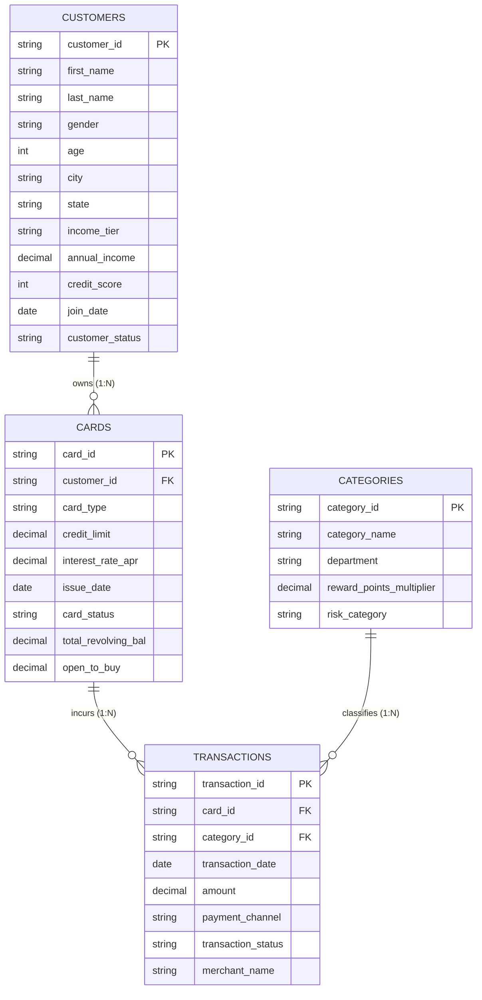

# DELIVERABLE 1: PROBLEM STATEMENT & DATA DICTIONARY

**Student Name:** Saqhiya Parveen  
**Project ID:** DA-12  
**Project Title:** Credit Card Spend & Customer Behaviour  
**Domain:** Banking & Finance  
**Primary Business Question:** *How do customers spend and who is inactive?*  
**Assigned Deliverable:** Problem Statement, KPIs, and Column-by-Column Data Dictionary  

---

## 1. Executive Problem Statement

### 1.1 Business Context & Industry Background
In the retail banking and consumer credit card industry, profitability is driven by two interdependent levers: **transaction volume** (which generates merchant interchange fee revenue of ~1.5% to 2.5%) and **revolving credit balances** (which yield interest income via Annual Percentage Rate [APR] charges). Concurrently, credit card issuers incur substantial Customer Acquisition Costs (CAC), ranging between ₹2,500 and ₹5,000 per cardholder, comprising marketing, credit underwriting, onboarding, and card issuance costs.

Despite substantial acquisition investments, card issuers face an industry-wide **dormancy and attrition rate** of 15% to 22%. A dormant cardholder not only generates zero interchange and interest income, but also ties up valuable capital allocation reserves under regulatory risk-weighted capital adequacy requirements (RBI/Basel III guidelines). Unused credit lines represent unmonetized credit exposure and opportunity cost.

### 1.2 Core Business Problem
Our bank's credit card portfolio is experiencing declining spend velocity and an increasing proportion of inactive accounts. Portfolio managers lack granular visibility into:
1. **Spending Patterns:** How do cardholders distribute their spends across merchant categories, card tiers, channels, and calendar months?
2. **Inactivity Identification:** Which customers have stopped spending, at what point in their lifecycle does dormancy occur, and what are the demographic or financial markers of inactivity?
3. **Retention & Monetization:** What actionable customer segments exist to trigger automated re-engagement, prevent churn, and optimize credit limits?

### 1.3 Key Objectives & Deliverables
- Ingest and model relational credit card data across four core entities: `customers`, `cards`, `transactions`, and `categories`.
- Diagnose data quality anomalies (missing values, inconsistent text, anomalous outliers, formatting variance) and build a production-grade data cleaning workflow.
- Execute multi-table SQL queries utilizing CTEs, window functions, and aggregations to answer portfolio spend and dormancy questions.
- Conduct in-depth Exploratory Data Analysis (EDA) in Python to visualize spending concentrations, RFM segments, and inactivity drivers.
- Construct an executive interactive dashboard providing real-time visibility into portfolio KPIs and inactivity alerts.
- Deliver executive-grade business recommendations to re-engage dormant cardholders and maximize portfolio lifetime value (LTV).

---

## 2. Key Performance Indicators (KPIs) to Answer

The project is structured to measure, track, and answer the following core business metrics:

| KPI Category | Metric Name | Definition & Business Formula | Target / Benchmark |
| :--- | :--- | :--- | :--- |
| **Spend Velocity** | **Total Spend Volume (GMV)** | $\sum \text{Transaction Amount}$ across approved transactions | Maximize portfolio GMV |
| **Transaction Dynamics** | **Average Ticket Size (ATV)** | $\frac{\text{Total Spend Volume}}{\text{Total Transaction Count}}$ | Measure transaction depth |
| **Portfolio Health** | **Active Customer Ratio** | $\frac{\text{Customers with } \ge 1 \text{ transaction in past 90 days}}{\text{Total Cardholders}} \times 100$ | Industry benchmark $> 80\%$ |
| **Dormancy / Churn** | **Portfolio Inactivity Rate** | $\frac{\text{Customers with zero transactions in } \ge 180 \text{ days}}{\text{Total Cardholders}} \times 100$ | Target $< 15\%$ |
| **Credit Utilization** | **Average Credit Utilization** | $\frac{\sum \text{Total Revolving Balance}}{\sum \text{Credit Limit}} \times 100$ | Healthy range $20\% - 45\%$ |
| **Share of Wallet** | **Category Spend Share** | $\frac{\text{Spend in Category } i}{\text{Total Portfolio Spend}} \times 100$ | Identify top spend drivers |
| **Customer Value** | **RFM Value Segment** | Recency (days since last spend), Frequency (tx count), Monetary (total spend) | Segment into 4 tiers |
| **Capital Risk** | **Idle Credit Line Exposure** | $\sum \text{Credit Limit of Inactive Cardholders}$ | Minimize unutilized capital |

---

## 3. Comprehensive Column-by-Column Data Dictionary

The project utilizes a 4-table relational star-snowflake schema designed around credit card portfolio operations.

### Table 1: `categories` (Master Reference Table)
*Stores metadata regarding merchant expense categories, reward point incentives, and transaction risk tiers.*

| Column Name | Data Type | Key / Constraint | Nullable | Description & Business Rules | Example Values |
| :--- | :--- | :--- | :--- | :--- | :--- |
| `category_id` | `VARCHAR(10)` | **Primary Key** | NO | Unique 5-character identifier for the expense category. | `CAT01`, `CAT02`, `CAT05` |
| `category_name` | `VARCHAR(50)` | UNIQUE, NOT NULL | NO | Standardized commercial merchant category name. | `Groceries & Supermarket`, `Dining & Restaurants` |
| `department` | `VARCHAR(30)` | NOT NULL | NO | High-level business classification for reporting. | `Retail`, `Food & Beverage`, `Travel`, `Bills` |
| `reward_points_multiplier`| `DECIMAL(3,1)` | CHECK ($\ge 1.0$) | NO | Multiplier for reward points earned per ₹100 spent. | `1.0`, `1.5`, `2.0`, `3.0` |
| `risk_category` | `VARCHAR(15)` | CHECK in ('Low','Medium','High') | NO | Fraud and chargeback risk rating classification. | `Low`, `Medium`, `High` |

---

### Table 2: `customers` (Master Entity Table)
*Stores demographic, geographic, financial tier, and account activity status for every onboarded cardholder.*

| Column Name | Data Type | Key / Constraint | Nullable | Description & Business Rules | Example Values |
| :--- | :--- | :--- | :--- | :--- | :--- |
| `customer_id` | `VARCHAR(12)` | **Primary Key** | NO | Unique system identifier for customer (`CUST` + 5 digits). | `CUST00001`, `CUST01180` |
| `first_name` | `VARCHAR(40)` | NOT NULL | NO | Cardholder's legal first name. | `Aarav`, `Pooja`, `Kunal` |
| `last_name` | `VARCHAR(40)` | NOT NULL | NO | Cardholder's legal last name. | `Sharma`, `Verma`, `Reddy` |
| `gender` | `VARCHAR(10)` | CHECK in ('Male','Female') | NO | Self-identified customer gender. | `Male`, `Female` |
| `age` | `INTEGER` | CHECK ($age \ge 18$) | NO | Customer age in completed years (Range: 21–72). | `28`, `42`, `55` |
| `city` | `VARCHAR(40)` | NOT NULL | NO | Residential metropolitan city in India. | `Mumbai`, `Bengaluru`, `Delhi` |
| `state` | `VARCHAR(40)` | NOT NULL | NO | Corresponding state or union territory. | `Maharashtra`, `Karnataka` |
| `income_tier` | `VARCHAR(25)` | NOT NULL | NO | Socioeconomic segmentation based on verified earnings. | `Lower-Middle`, `Middle`, `Upper-Middle`, `High-Net-Worth` |
| `annual_income` | `DECIMAL(12,2)`| CHECK ($> 0$) | NO | Verified gross annual income in Indian Rupees (INR). | `450000.00`, `1800000.00` |
| `credit_score` | `INTEGER` | CHECK (300 to 900) | NO | CIBIL/Experian equivalent bureau credit score. | `685`, `742`, `810` |
| `join_date` | `DATE` | NOT NULL | NO | Date when customer opened first bank account (YYYY-MM-DD).| `2021-03-15`, `2023-11-04` |
| `customer_status` | `VARCHAR(15)` | CHECK in ('Active','Inactive') | NO | Overall portfolio engagement flag based on activity. | `Active`, `Inactive` |

---

### Table 3: `cards` (Master / Relationship Table)
*Stores specific card issuance instances, card types, credit limits, interest rates, and revolving balances. Linked to `customers` via 1-to-Many relationship (a customer may hold primary and secondary cards).*

| Column Name | Data Type | Key / Constraint | Nullable | Description & Business Rules | Example Values |
| :--- | :--- | :--- | :--- | :--- | :--- |
| `card_id` | `VARCHAR(12)` | **Primary Key** | NO | Unique card account number token (`CRD` + 5 digits). | `CRD00001`, `CRD01450` |
| `customer_id` | `VARCHAR(12)` | **Foreign Key** (`customers.customer_id`) | NO | Parent customer who owns the credit facility. | `CUST00042` |
| `card_type` | `VARCHAR(20)` | CHECK in ('Silver','Gold','Platinum','Signature') | NO | Tier of the card determining benefits and limits. | `Silver`, `Gold`, `Platinum`, `Signature` |
| `credit_limit` | `DECIMAL(12,2)`| CHECK ($> 0$) | NO | Sanctioned maximum credit limit in INR. | `100000.00`, `500000.00`, `1200000.00` |
| `interest_rate_apr`| `DECIMAL(5,2)` | CHECK ($> 0$) | NO | Annual Percentage Rate charged on revolving balances. | `38.00`, `35.00`, `30.00`, `24.00` |
| `issue_date` | `DATE` | NOT NULL | NO | Card issuance and activation date. | `2022-01-10`, `2024-05-18` |
| `card_status` | `VARCHAR(15)` | CHECK in ('Active','Inactive','Blocked') | NO | Operational status of the card token. | `Active`, `Inactive`, `Blocked` |
| `total_revolving_bal`| `DECIMAL(12,2)`| CHECK ($\ge 0$) | NO | Current unpaid revolving credit balance in INR. | `12450.00`, `85200.00` |
| `open_to_buy` | `DECIMAL(12,2)`| $\text{limit} - \text{balance}$ | NO | Remaining spendable credit balance available. | `87550.00`, `414800.00` |

---

### Table 4: `transactions` (Transactional Fact Table)
*Stores individual transaction occurrences, timestamps, amounts, channels, authorization status, and merchant details.*

| Column Name | Data Type | Key / Constraint | Nullable | Description & Business Rules | Example Values |
| :--- | :--- | :--- | :--- | :--- | :--- |
| `transaction_id` | `VARCHAR(15)` | **Primary Key** | NO | Unique transactional reference identifier (`TXN` + 7 digits). | `TXN0000001`, `TXN0021469` |
| `card_id` | `VARCHAR(12)` | **Foreign Key** (`cards.card_id`) | NO | Token of the card utilized for payment. | `CRD00015` |
| `category_id` | `VARCHAR(10)` | **Foreign Key** (`categories.category_id`)| NO | Merchant Category Code (MCC) grouping identifier. | `CAT01`, `CAT03` |
| `transaction_date`| `DATE` | NOT NULL | NO | Timestamp date of transaction authorization (YYYY-MM-DD).| `2024-08-14`, `2025-11-20` |
| `amount` | `DECIMAL(10,2)`| CHECK ($> 0$) | NO | Transaction ticket size in INR. | `1450.00`, `18900.00` |
| `payment_channel` | `VARCHAR(25)` | CHECK in ('POS Swipe','Online Payment','Contactless Tap','ATM Withdrawal') | NO | Payment acceptance modality. | `Online Payment`, `POS Swipe` |
| `transaction_status`| `VARCHAR(15)`| CHECK in ('Approved','Declined','Refunded') | NO | Transaction settlement and authorization result. | `Approved`, `Declined`, `Refunded` |
| `merchant_name` | `VARCHAR(60)` | NOT NULL | NO | Commercial legal name of accepting merchant. | `Reliance Smart`, `IndiGo Airlines` |

---

## 4. Entity-Relationship (ER) Architecture

---

## 5. Data Source, Scope, and Licensing

- **Data Source Type:** Curated Banking & Credit Card Benchmark Dataset inspired by Kaggle's *Credit Card Customers / Bank Churners* benchmark repository, tailored to Indian banking dynamics (INR currency, major Indian metropolitan clusters, GST compliance, and domestic merchant ecosystems).
- **Time Horizon:** 18 calendar months spanning **July 1, 2024 to December 31, 2025**.
- **Portfolio Scale:** 1,200 unique retail customers, 1,480 issued credit cards, 10 standardized merchant categories, and 21,000+ transactional records.
- **Licensing & Governance:** Open Database License (ODbL) / Creative Commons CC-BY 4.0 compliant. All customer names, identifiers, and transactional records are privacy-safe synthetic data containing zero Personally Identifiable Information (PII) or proprietary banking secrets.
