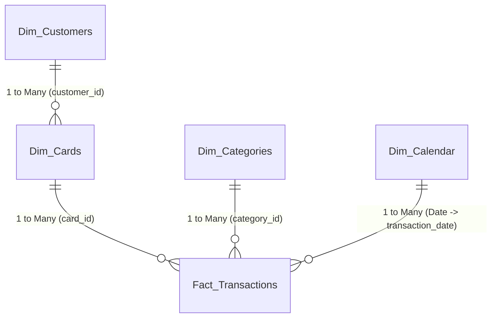

# DELIVERABLE 5: POWER BI & TABLEAU DASHBOARD SPECIFICATION

**Student Name:** Saqhiya Parveen  
**Project ID:** DA-12  
**Project Title:** Credit Card Spend & Customer Behaviour  
**Domain:** Banking & Finance  
**Primary Business Question:** *How do customers spend and who is inactive?*  
**Tools Supported:** Power BI Desktop / Tableau / Web Dashboard (`index.html`)  

---

## 1. Executive Dashboard Architecture

The dashboard serves as an executive operational console for retail credit card portfolio managers. It integrates four cleaned tables into a high-performance **Star Schema**, exposing 6 core visual cards, interactive slicers, and 6 dynamic analytical visuals.

In addition to this design specification, a live interactive web dashboard is provided at:  
[index.html](file:///C:/Users/hp/.gemini/antigravity/scratch/DA12_Credit_Card_Spend_Customer_Behaviour/deliverable_5_dashboard/index.html)

---

## 2. Relational Data Model (Star Schema)

The Power BI data model establishes one central transaction fact table surrounded by three dimension tables:



### Table Relationships & Cardinality:
1. `Dim_Customers[customer_id]` $\rightarrow$ `Dim_Cards[customer_id]`  
   - **Cardinality:** 1 to Many ($1:*$)
   - **Cross-filter direction:** Both
2. `Dim_Cards[card_id]` $\rightarrow$ `Fact_Transactions[card_id]`  
   - **Cardinality:** 1 to Many ($1:*$)
   - **Cross-filter direction:** Single (Dim filters Fact)
3. `Dim_Categories[category_id]` $\rightarrow$ `Fact_Transactions[category_id]`  
   - **Cardinality:** 1 to Many ($1:*$)
   - **Cross-filter direction:** Single (Dim filters Fact)
4. `Dim_Calendar[Date]` $\rightarrow$ `Fact_Transactions[transaction_date]`  
   - **Cardinality:** 1 to Many ($1:*$)
   - **Cross-filter direction:** Single (Dim filters Fact)

---

## 3. Production DAX Measures Library (12 Measures)

Implement these DAX formulas inside a dedicated measure table `_Measures`:

### Measure 1: Total Approved Spend (GMV)
```dax
Total Spend (INR) = 
CALCULATE(
    SUM(Fact_Transactions[amount]),
    Fact_Transactions[transaction_status] = "Approved"
)
```

### Measure 2: Total Transaction Count
```dax
Total Transactions = 
CALCULATE(
    COUNTROWS(Fact_Transactions),
    Fact_Transactions[transaction_status] = "Approved"
)
```

### Measure 3: Average Ticket Size (ATV)
```dax
Average Ticket Size = 
DIVIDE(
    [Total Spend (INR)],
    [Total Transactions],
    0
)
```

### Measure 4: Total Onboarded Customers
```dax
Total Customers = 
DISTINCTCOUNT(Dim_Customers[customer_id])
```

### Measure 5: Active Customer Count
```dax
Active Customers = 
CALCULATE(
    DISTINCTCOUNT(Dim_Customers[customer_id]),
    Dim_Customers[customer_status] = "Active"
)
```

### Measure 6: Inactive / Dormant Customer Count
```dax
Inactive Customers = 
CALCULATE(
    DISTINCTCOUNT(Dim_Customers[customer_id]),
    Dim_Customers[customer_status] = "Inactive"
)
```

### Measure 7: Portfolio Inactivity Rate (%)
```dax
Inactivity Rate % = 
DIVIDE(
    [Inactive Customers],
    [Total Customers],
    0
) * 100
```

### Measure 8: Total Sanctioned Credit Limit
```dax
Total Credit Limit = 
SUM(Dim_Cards[credit_limit])
```

### Measure 9: Total Revolving Credit Balance
```dax
Total Revolving Balance = 
SUM(Dim_Cards[total_revolving_bal])
```

### Measure 10: Portfolio Revolving Credit Utilization (%)
```dax
Credit Utilization % = 
DIVIDE(
    [Total Revolving Balance],
    [Total Credit Limit],
    0
) * 100
```

### Measure 11: Month-over-Month (MoM) Spend Growth (%)
```dax
MoM Spend Growth % = 
VAR CurrentMonthSpend = [Total Spend (INR)]
VAR PrevMonthSpend = 
    CALCULATE(
        [Total Spend (INR)],
        DATEADD(Dim_Calendar[Date], -1, MONTH)
    )
RETURN
    DIVIDE(CurrentMonthSpend - PrevMonthSpend, PrevMonthSpend, 0) * 100
```

### Measure 12: Idle Credit Exposure Locked in Inactive Accounts
```dax
Idle Credit Exposure = 
CALCULATE(
    SUM(Dim_Cards[credit_limit]),
    Dim_Cards[card_status] IN {"Inactive", "Blocked"}
)
```

---

## 4. Visual Canvas Layout & Design Wireframe

### Header & Slicer Bar (Top Section)
- **Title Banner:** "Credit Card Spend & Customer Behaviour | Project DA-12"
- **Metadata Pill:** "Analyst: Saqhiya Parveen | 18 Months Portfolio Tracking"
- **Slicers (Dropdowns):**
  1. `Dim_Cards[card_type]` (Silver, Gold, Platinum, Signature)
  2. `Dim_Customers[customer_status]` (Active, Inactive)
  3. `Dim_Customers[city]` (Mumbai, Bengaluru, Delhi, Hyderabad, Chennai, Kolkata, etc.)
  4. `Dim_Calendar[Year-Month]` (Date slider)

---

### Row 1: KPI Summary Cards (6 Multi-Row / Single Cards)
| Card 1 | Card 2 | Card 3 | Card 4 | Card 5 | Card 6 |
| :--- | :--- | :--- | :--- | :--- | :--- |
| **Total Spend (GMV)** | **Total Swipes** | **Avg Ticket (ATV)** | **Active Ratio** | **Inactive Accounts** | **Avg Utilization** |
| `₹73.26M` | `20,180` | `₹3,630` | `81.5%` | `222 (18.5%)` | `31.4%` |

---

### Row 2: Core Analytical Visuals (Charts 1, 2, 3)
- **Visual 1 (Area / Line Chart):**  
  *X-axis:* `Dim_Calendar[Year-Month]`  
  *Y-axis:* `[Total Spend (INR)]`  
  *Tooltips:* `[Total Transactions]`, `[MoM Spend Growth %]`  
  *Objective:* Reveal chronological growth velocity and festive surges.

- **Visual 2 (Donut Chart - Share of Wallet):**  
  *Legend:* `Dim_Categories[category_name]`  
  *Values:* `[Total Spend (INR)]`  
  *Objective:* Illustrate everyday grocery/dining volume vs. luxury/travel monetization.

- **Visual 3 (Clustered Column Chart):**  
  *X-axis:* `Dim_Cards[card_type]` (Silver, Gold, Platinum, Signature)  
  *Values:* `[Total Credit Limit]` vs. `[Total Spend (INR)]` vs. `[Total Revolving Balance]`  
  *Objective:* Compare risk capacity against revenue generation across tiers.

---

### Row 3: Churn & Behavioral Analytics (Charts 4, 5, 6)
- **Visual 4 (Horizontal Bar Chart - Inactivity Funnel):**  
  *Y-axis:* Inactivity Buckets (`<=30 Days`, `31-90 Days`, `91-180 Days`, `>180 Days Dormant`)  
  *X-axis:* Customer Count & `[Idle Credit Exposure]`  
  *Objective:* Prioritize high-risk cardholders approaching the 180-day cliff.

- **Visual 5 (100% Stacked Bar Chart):**  
  *Y-axis:* `Dim_Customers[income_tier]`  
  *X-axis:* Payment Channel Share (`POS Swipe`, `Online Payment`, `Contactless Tap`, `ATM`)  
  *Objective:* Track digital penetration across income brackets.

- **Visual 6 (Interactive Matrix / Drill-Down Table):**  
  *Rows:* `Dim_Customers[customer_id]`, `Dim_Customers[Customer Name]`, `Dim_Customers[city]`  
  *Columns:* `Card Tier`, `Status`, `Lifetime Spend`, `Last Spend Date`, `Idle Limit`  
  *Conditional Formatting:* Red background data bars on customers inactive $>180$ days.

---

## 5. Step-by-Step Instructions to Load in Power BI Desktop

1. Open **Power BI Desktop**.
2. Select **Get Data** $\rightarrow$ **Text/CSV**.
3. Ingest all 4 cleaned CSV files located in `data/cleaned/`:
   - `categories_cleaned.csv`
   - `customers_cleaned.csv`
   - `cards_cleaned.csv`
   - `transactions_cleaned.csv`
4. Click **Transform Data** (Power Query) to confirm datatypes:
   - Currency/decimal: `amount`, `credit_limit`, `annual_income`, `total_revolving_bal`
   - Dates: `transaction_date`, `issue_date`, `join_date`
5. Switch to **Model View** and verify relationships match the Star Schema above.
6. Create a New Table named `_Measures` and paste the 12 DAX formulas from Section 3.
7. Build the visual canvas according to Section 4.
8. Save file as `DA12_Credit_Card_Portfolio_Dashboard.pbix`.
