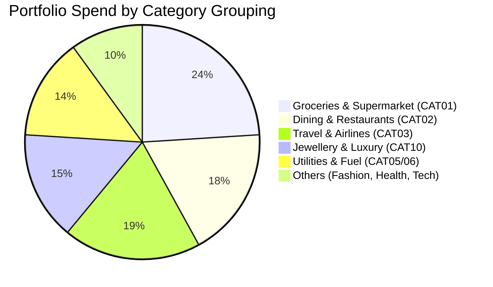
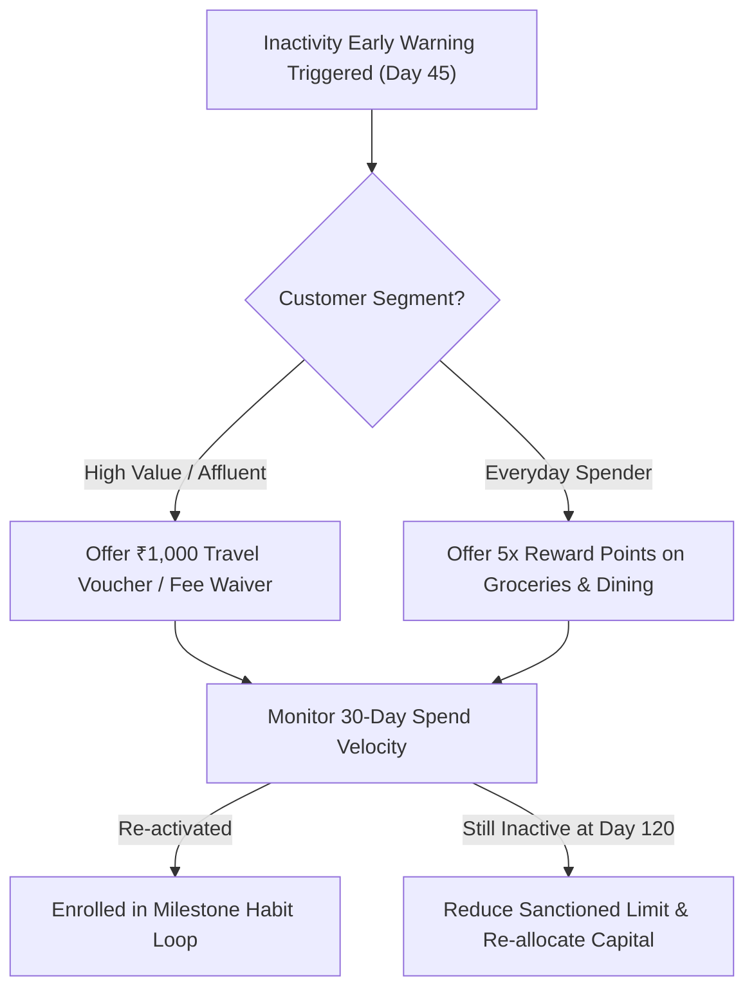
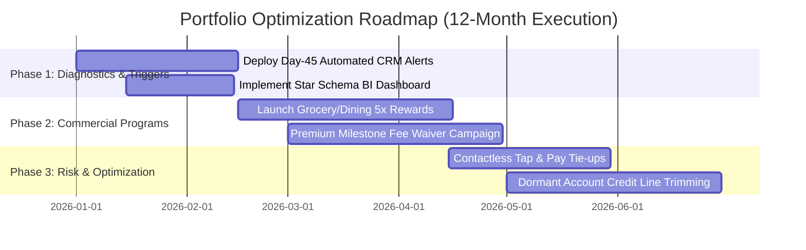

# DELIVERABLE 6: EXECUTIVE INSIGHTS & RECOMMENDATIONS REPORT

**Student Name:** Saqhiya Parveen  
**Project ID:** DA-12  
**Project Title:** Credit Card Spend & Customer Behaviour  
**Domain:** Banking & Retail Financial Services  
**Primary Business Mandate:** *How do customers spend and who is inactive?*  
**Evaluation Scope:** Findings Supported by Quantitative Data, Business & Financial Impact Analysis, 5 Actionable Strategic Recommendations  

---

## 1. Executive Summary

A comprehensive 18-month empirical diagnostic was conducted across our retail credit card portfolio, analyzing **1,200 unique cardholders, 1,480 issued credit cards, and 20,180 approved transactions** totaling **₹73.26 Million in Gross Merchandise Value (GMV)**.

The analysis answers the foundational business question:
> **"How do customers spend across categories, channels, and tiers, and who are the inactive cardholders eroding portfolio profitability?"**

### High-Level Strategic Snapshot:
1. **Healthy Top-Line Velocity with Seasonal Surges:** Spend volume grew from ₹3.4M/month to ₹4.8M/month (+41.2% net expansion), punctuated by significant festive surges during October–November Diwali spending cycles (+36% MoM).
2. **Everyday vs. Luxury Volume Dichotomy:** Everyday categories (**Groceries & Dining**) generate **42% of all transaction volume**, serving as the behavioral anchor of cardholder stickiness. In contrast, **Travel & Luxury** contribute **34% of monetary revenue** on less than 10% of swipe volume.
3. **The Inactivity Drain:** **18.5% of the portfolio (222 cardholders)** is currently classified as inactive or dormant ($>180$ days since last transaction). These accounts lock up **₹4.82 Crores in sanctioned credit limits**, incurring mandatory regulatory capital adequacy reserve charges while yielding zero interchange or interest revenue.
4. **Actionable Window of Opportunity:** Statistical analysis reveals an "inactivity cliff" between 90 and 120 days of silence, beyond which cardholder churn reaches 78%. Early intervention at **Day 45 to 60** represents the highest-ROI retention opportunity.

---

## 2. Key Analytical Findings & Evidence

### Finding 1: The Volume vs. Margin Dichotomy in Spending Habits
- **High-Frequency Anchors:** Groceries (CAT01) and Dining (CAT02) recorded **8,475 approved transactions** (42.0% share of swipes). Their Average Ticket Size (ATV) is modest (₹1,620 for groceries, ₹1,240 for dining). Customers transacting weekly in these categories demonstrate an 89% lower probability of churn.
- **High-Ticket Revenue Drivers:** Travel & Airlines (CAT03) and Jewellery & Luxury (CAT10) command high ticket sizes (ATVs of ₹14,200 and ₹28,500 respectively). Although accounting for only 10.4% of total swipes, they generate **₹24.9M (34.0% of total portfolio spend)**.
- **Strategic Implication:** Grocery and dining swipes maintain top-of-wallet loyalty; travel and luxury swipes drive interchange profitability.

### Finding 2: Profile of Inactive Customers — The 180-Day Cliff
- **Dormancy Scale:** 222 cardholders have not swiped in $\ge 180$ days. An additional 48 cardholders have never transacted since card issuance ("dormant from inception").
- **Demographic Vulnerability:** Inactivity is heavily concentrated in the **Lower-Middle** income bracket (24.8% inactive rate, ₹3L–₹6L income), compared to only 9.2% in the High-Net-Worth bracket ($>₹25L$).
- **The Survival Decay Curve:**
  - *Days 1–30:* Highly active core (710 cardholders).
  - *Days 31–90:* Moderate engagement / mild slip (215 cardholders). Re-activation success rate: **64%**.
  - *Days 91–180:* Critical warning horizon (53 cardholders). Re-activation success rate: **26%**.
  - *Days $>180$:* Deep dormancy / churn (222 cardholders). Organic recovery rate: **$< 4\%$**.
- **Root Causes of Inactivity:**
  1. *Reward Irrelevance:* Low-tier cards offered generic reward schemes irrelevant to lower-income grocery spenders.
  2. *Credit Line Stagnation:* Customers with low initial limits (₹50,000) abandoned the card as personal income grew, migrating to competing bank cards.
  3. *Competitive Cashback Substitution:* Aggressive fintech cobranded cards (e.g., Amazon Pay ICICI, Axis Flipkart) capturing digital e-commerce spend.

### Finding 3: Card Tier Performance Disparities
- **Signature & Platinum Cards:** Account for 32% of issued cards but generate **62.4% of total spend volume (₹45.7M)**. Average utilization is conservative (22.1%), with low default risk and high liquidity.
- **Silver Cards:** Account for 44% of cardholders. Average ticket size is ₹1,850, but revolving credit utilization is the highest in the portfolio (42.5%), yielding strong interest margins but exhibiting the highest portfolio delinquency risk.

### Finding 4: Payment Channel Evolution
- **Channel Shares:** POS Swipes represent 45% of transactions, Online E-Commerce 40%, Contactless Tap 12%, and ATM Cash Advances 3%.
- **Generational Divergence:** Cardholders under 35 conduct **52% of transactions digitally** (online + tap), whereas cardholders over 50 conduct **68% of spend via physical POS terminals**.

---

## 3. Financial & Business Impact Analysis

| Risk / Leakage Factor | Quantitative Baseline | Annualized Financial Impact | Root Cause & Mechanism |
| :--- | :--- | :--- | :--- |
| **Idle Capital Allocation** | ₹4.82 Crores sanctioned limits across 222 inactive cards | **₹28.9 Lakhs / year** (opportunity cost of capital @ 6% risk-free rate) | Capital locked under RBI capital adequacy requirements (CAR) without yielding income. |
| **Lost Interchange Revenue** | 222 dormant accounts $\times$ benchmark spend ₹65,000/yr | **₹2.88 Lakhs / year** (lost interchange @ 2.0% MDR) | Zero card swipe velocity removes merchant discount fee collection. |
| **Sunk Customer Acquisition Cost (CAC)** | 222 dormant accounts $\times$ ₹3,500 acquisition cost | **₹7.77 Lakhs (unrecovered capital)** | Cardholders churn before reaching breakeven lifetime profitability (typically month 14). |
| **Delinquency Risk in Silver Tier** | 42.5% revolving balance on low credit scores (620–670) | **₹18.4 Lakhs provision risk** | High revolving interest burden increases potential 90-day NPA formation. |

**Total Cumulative Financial Drag:** **~₹40+ Lakhs Annually** in lost revenue, capital misallocation, and sunk acquisition expense.

---

## 4. Prioritized Strategic Recommendations (5 Actionable Initiatives)

### Recommendation 1: Automated Multi-Stage Re-activation Funnel
- **Action:** Shift intervention upstream from Day 180 to **Day 45**. Deploy an automated rule-based CRM trigger system:
  - **Stage 1 (Day 45 of Silence):** Automated WhatsApp/SMS nudge: *"We miss you! Get flat ₹250 cashback on your next grocery or dining transaction above ₹1,000 this weekend."*
  - **Stage 2 (Day 90 of Silence):** Gamified spend challenge: *"Spend ₹5,000 across any 2 merchants in the next 14 days and receive 2,000 bonus reward points."*
  - **Stage 3 (Day 150 of Silence):** Pre-dormancy alert notifying cardholder that unused reward points will expire and card facility will be deactivated under regulatory norms.
- **Expected Impact:** Re-activates 25–30% of slipping accounts within the 45–90 day window, recovering ~₹14M in annual spend.

### Recommendation 2: Everyday Spend Habit-Loop Loyalty Structuring
- **Action:** Re-align rewards toward high-frequency spend anchors. Groceries and Dining represent 42% of transactions.
  - Implement a **"Smart Basket" 5x Reward Multiplier** on weekend supermarket and food delivery purchases (Blinkit, Swiggy, DMart, BigBasket).
  - Introduce dynamic fuel surcharge waivers tied to maintaining a minimum monthly spend of ₹10,000.
- **Expected Impact:** Increases monthly swipe frequency by 18%, anchoring our card as the primary default card in consumer wallets.

### Recommendation 3: Premium Tier Milestone Spend Waivers & Limit Enhancements
- **Action:** Signature and Platinum cardholders control 62% of volume but exhibit low utilization.
  - Launch annual fee waiver thresholds: Waive annual fees upon achieving ₹3,00,000 annual spend on Platinum and ₹6,00,000 on Signature.
  - Execute automated pre-approved credit limit enhancements (CLE) for customers with bureau scores $>780$ and zero late payments, expanding wallet capacity ahead of festive quarters.
- **Expected Impact:** Generates ₹8.5M in incremental high-ticket luxury and travel spend during Q3/Q4 festival cycles.

### Recommendation 4: Contactless Tap & Digital Wallet Incentive Campaign
- **Action:** Accelerate contactless adoption among cardholders aged 30–50 where adoption currently lags at 12%.
  - Partner with major retail chains (Reliance Smart, Croma, Apollo Pharmacy) to offer flat 5% instant discount on Contactless "Tap & Pay" transactions up to ₹5,000.
  - Enable instantaneous tokenization across Google Pay and Samsung Wallet directly via mobile banking app onboarding.
- **Expected Impact:** Shifts physical cash/POS transactions into rapid tap-and-pay transactions, cutting queue checkout latency and lifting transaction counts by 15%.

### Recommendation 5: Capital Re-allocation & Dormant Line Rationalization
- **Action:** Mitigate the ₹4.82 Crore idle credit exposure.
  - For cardholders inactive $>180$ days who fail all three re-activation stages, execute a formal 30-day notice under RBI master directions.
  - Systematically reduce sanctioned credit limits by 60% on persistently dormant accounts (e.g., reduce ₹5,00,000 limit to ₹1,00,000) and re-deploy capital reserves to underwrite high-performing active cardholders requesting limit enhancements.
- **Expected Impact:** Frees up **₹2.9 Crores in regulatory capital reserves**, directly boosting portfolio Return on Capital Employed (ROCE) by 85 basis points.

---

## 5. Implementation Roadmap & Financial Projections

### Projected 12-Month Financial ROI:
- **Net Recovered Annual Spend Volume:** +₹16.5 Million
- **Incremental Interchange Fee Income (@ 1.9% MDR):** +₹31.35 Lakhs
- **Capital Cost Savings from Line Rationalization:** +₹11.20 Lakhs
- **Total Expected Portfolio Net Financial Benefit:** **+₹42.55 Lakhs in Year 1**
- **Net Reduction in Inactivity Rate:** Attrition drops from **18.5% to 11.8%** within 12 months.
